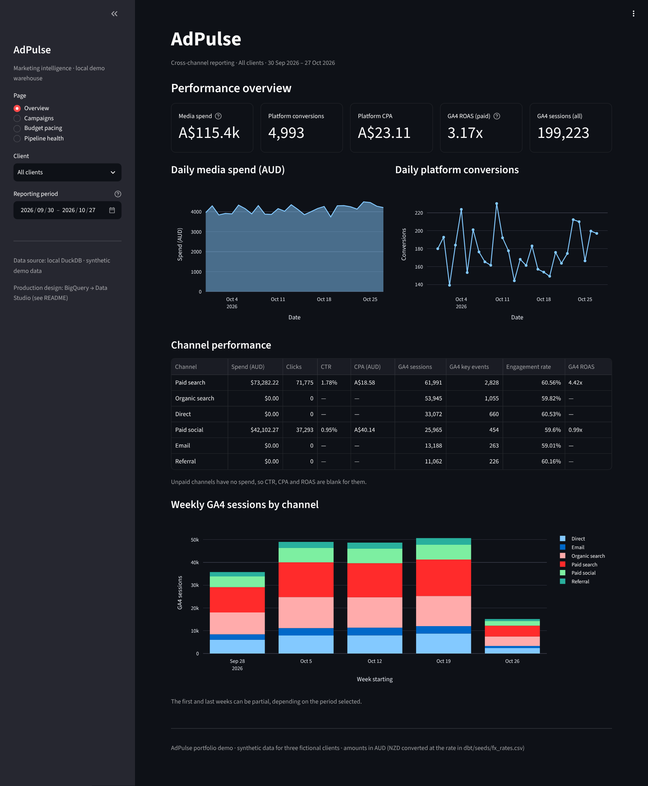
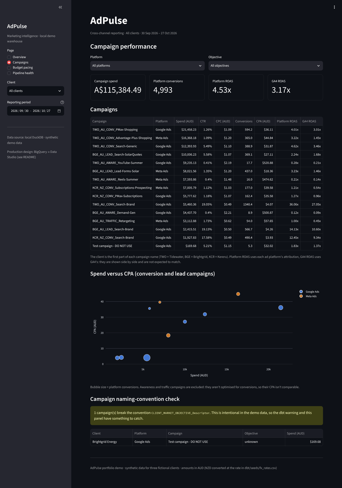
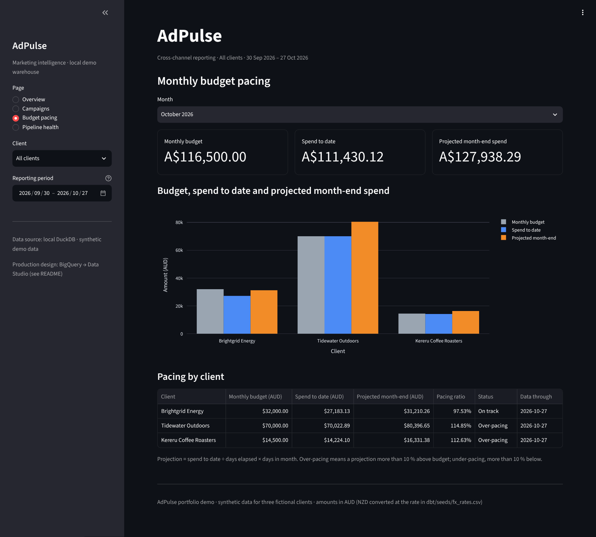
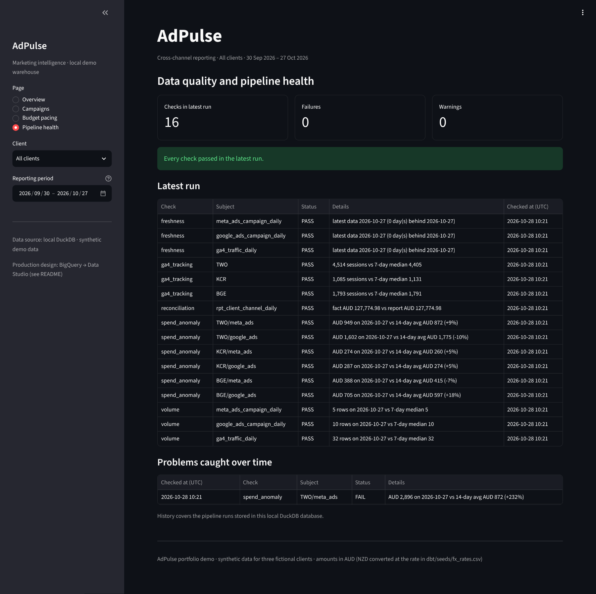
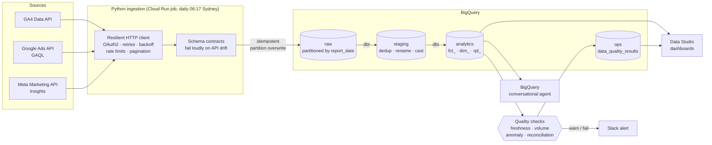
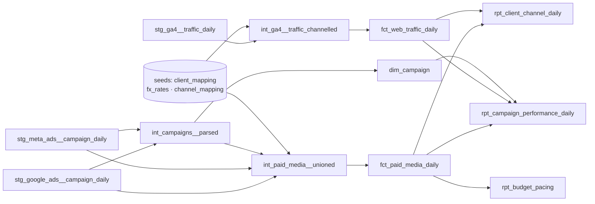

# AdPulse — Marketing Data Platform on BigQuery

[](../../actions/workflows/ci.yml)

An end-to-end marketing reporting pipeline of the kind a media agency runs for its
clients: **GA4, Google Ads and Meta Ads → Python ingestion → BigQuery → dbt models
→ data-quality checks and alerting → Data Studio dashboards**.

It is built to be *trusted*, not just to run: every number on the dashboard has a
written definition, every load is idempotent, and broken pipelines or stale data
are caught by the pipeline before a client or account manager notices.

> **Try it in 2 minutes, no cloud account needed.** A demo mode generates realistic
> data for three fictional clients and runs the whole pipeline locally on DuckDB.
> The same code runs against real APIs and BigQuery in production.

```bash
git clone <this repo> && cd marketing-data-platform
python -m venv .venv && source .venv/bin/activate   # Windows: .venv\Scripts\activate
pip install -e ".[dev]"
make demo            # 90 days of data → extract → load → dbt build (58 models/tests) → checks
make demo-anomaly    # 4× budget-typo spend spike → the pipeline catches it and exits 1
make dashboard       # Streamlit dashboard on the local warehouse (http://localhost:8501)
```

Without `make` (e.g. Windows CMD): `adpulse run --mode demo --days 90`, then `streamlit run app.py`.

### What runs locally vs. what is designed for production

| | Local demo (verified, runs in CI) | Production design |
|---|---|---|
| Data | Synthetic GA4 / Google Ads / Meta data for three fictional clients | Real APIs (GA4 Data API, Google Ads API, Meta Marketing API) |
| Warehouse | DuckDB file (`warehouse/adpulse.duckdb`, not committed) | BigQuery, partitioned and clustered |
| Transformations | The same dbt project, `duckdb` target | The same dbt project, `bigquery` target |
| Checks and alerts | Same checks; alerts printed to the console | Same checks; alerts sent to Slack |
| Dashboard | Streamlit app (`app.py`), screenshots below | Data Studio report ([build guide](docs/data_studio_guide.md)) |
| Scheduling | Run by hand | Cloud Run job + Cloud Scheduler |

Everything in the left column is exercised by the test suite. The connectors, the BigQuery
warehouse class and the deploy script are written and unit-tested against mocked APIs, but
the screenshots in this README come from the local demo, not from client data.

---

## Dashboard (local demo)

A four-page Streamlit app reads the dbt marts directly. One sidebar date range and client
filter drive every page. All figures are synthetic.

**Overview**: spend, conversions, CPA and paid-channel GA4 ROAS, with daily trends and a
channel breakdown.



**Campaigns**: per-campaign efficiency, with platform-reported and GA4-attributed ROAS side
by side. The naming-convention warning at the bottom is intentional: the demo data contains
a `Test campaign - DO NOT USE` that breaks the `CLIENT_MARKET_OBJECTIVE_Name` convention,
to show the check working.



**Budget pacing**: month-to-date spend against budget, projected to month end.



**Pipeline health**: freshness and data-quality results from the latest run, plus a history
of problems caught (here, the spend spike injected by `make demo-anomaly`).



Two rules keep the numbers consistent across pages:

- Ratios (CTR, CPC, CPA, ROAS) are always `SUM(numerator) / SUM(denominator)`, never an
  average of daily ratios.
- GA4 ROAS divides **paid-channel** GA4 revenue by media spend. Including organic and direct
  revenue would overstate it (5.20x instead of 3.17x on the demo data).
  `python scripts/check_dashboard_data.py` reconciles the dashboard totals against the marts.

---

## Architecture



| Layer | What it does | Where |
|---|---|---|
| Ingestion | One connector per platform. OAuth2 refresh-token flow, API keys/tokens from Secret Manager, pagination (page tokens, offsets, `paging.next`), client-side rate limiting, exponential backoff with jitter, `Retry-After`, Meta's HTTP-400 throttling codes | [`src/adpulse/connectors/`](src/adpulse/connectors) · [`http.py`](src/adpulse/http.py) |
| Raw | Every table built from one schema contract; partitioned by `report_date`, clustered by account/campaign; a 30-day window re-loaded daily by partition overwrite | [`schemas.py`](src/adpulse/schemas.py) · [`warehouse/`](src/adpulse/warehouse) |
| Modelling | dbt: staging → intermediate → marts. Incremental fact tables (`insert_overwrite` on BigQuery), pre-aggregated reporting tables for dashboards, documented metric definitions pushed into BigQuery | [`dbt/`](dbt) |
| Trust | 43 dbt tests (grain, nulls, relationships, clicks ≤ impressions, spend reconciliation) + post-load checks (freshness, volume, spend anomalies, GA4 tag health) → `ops.data_quality_results` + Slack | [`dbt/tests/`](dbt/tests) · [`quality/`](src/adpulse/quality) |
| Orchestration | Docker image → Cloud Run job, triggered by Cloud Scheduler; BigQuery scheduled query for daily pacing snapshots | [`Dockerfile`](Dockerfile) · [`infra/`](infra) |
| CI | Lint, 25 unit + end-to-end tests, full demo pipeline and dbt build on every push; dbt docs published to GitHub Pages | [`.github/workflows/ci.yml`](.github/workflows/ci.yml) |

---

## The data model



| Model | Grain | Used for |
|---|---|---|
| `fct_paid_media_daily` | date × platform × campaign | Source of truth for spend and platform-reported results (incremental, partitioned, clustered) |
| `fct_web_traffic_daily` | date × GA4 property × source × medium × campaign | Sessions, key events, revenue as GA4 sees them |
| `dim_campaign` | platform × campaign | Client, market, objective; naming-convention compliance |
| `rpt_client_channel_daily` | date × client × channel | **Executive overview page** — spend and GA4 outcomes on one row |
| `rpt_campaign_performance_daily` | date × platform × campaign | **Campaign drill-down page** — platform vs GA4 side by side |
| `rpt_budget_pacing` | client × month | **Pacing page** — month-to-date spend vs budget, projected month end |

Every metric is defined in [docs/metric_definitions.md](docs/metric_definitions.md),
and the same descriptions are written onto the BigQuery columns by dbt (`persist_docs`).

---

## Design decisions (and why)

**Store additive measures; compute ratios at query time.** Tables hold spend,
clicks, conversions — never CTR, CPA or ROAS. A daily ROAS averaged over a month is
wrong; `SUM(value) / SUM(spend)` is right. Data Studio calculated fields are defined
that way (see the [build guide](docs/data_studio_guide.md)), and the rule is written
into the [instructions for the BigQuery data agent](docs/bigquery_data_agent.md) so
natural-language questions get the right answer too.

**Re-pull a 30-day window every day.** Google Ads and Meta keep attributing
conversions to past clicks for weeks. Loading only "yesterday" means last week's
numbers never update. Each run overwrites the last 30 days' partitions, which is
idempotent: running it twice, or backfilling while the schedule runs, can never
double-count spend.

**An empty extract never deletes data.** If an API returns nothing for a day (an
outage, a revoked token), that day's partition is left untouched and the freshness
and volume checks flag it. Silently wiping a day of spend would be far worse than
showing slightly stale numbers.

**Compare like with like.** Meta's "clicks" includes likes and photo expands;
`inline_link_clicks` is what's comparable to a Google Ads click. Meta reports one
purchase under several action types (`purchase`, `omni_purchase`, pixel purchase);
summing them double-counts, so one type is chosen by priority and recorded.

**Platform and GA4 numbers are both shown, never blended into one "conversions".**
They use different attribution models and will never match. The campaign page puts
them side by side so an account manager can explain the gap rather than be
surprised by it.

**Client comes from the ad account, not the campaign name.** Names are typed by
people. The naming convention (`TWO_AU_CONV_Search-Brand`) supplies objective and
market; the account mapping is the source of truth for client; a test flags any
campaign whose name disagrees with its account, or that breaks the convention.

**Cost is a design constraint.** Partitioning + clustering on every large table,
small pre-aggregated `rpt_` tables for dashboards, `maximum_bytes_billed` on every
dbt and pipeline query, and [queries to see where BigQuery spend goes](infra/bigquery/cost_monitoring.sql).
More in [docs/cost_and_performance.md](docs/cost_and_performance.md).

**Local and production run the same code.** DuckDB stands in for BigQuery locally
and in CI, with dialect differences isolated in a few dispatched dbt macros
(`regex_match`, partition/cluster configs, incremental strategy).

---

## What the checks catch

```text
$ make demo-anomaly
...
Done. PASS=57 WARN=1 ERROR=0 SKIP=0 TOTAL=58        ← dbt: the WARN is a campaign named "Test campaign - DO NOT USE"

Data quality results
  PASS  freshness ga4_traffic_daily              latest data 2026-10-26 (0 day(s) behind 2026-10-26)
  PASS  volume meta_ads_campaign_daily           5 rows on 2026-10-26 vs 7-day median 5
  FAIL  spend_anomaly TWO/meta_ads               AUD 2,713 on 2026-10-26 vs 14-day avg AUD 862 (+215%)
  PASS  ga4_tracking TWO                         4,800 sessions vs 7-day median 4,342
  PASS  reconciliation rpt_client_channel_daily  fact AUD 127,853.15 vs report AUD 127,853.15
  ...
:red_circle: *spend_anomaly* · TWO/meta_ads: AUD 2,713 on 2026-10-26 vs 14-day avg AUD 862 (+215%)
pipeline finished  exit_code=1
```

| Check | Catches |
|---|---|
| `freshness` | A source stopped delivering (expired token, API change) |
| `volume` | A day arrived with far fewer rows than usual (partial extract) |
| `spend_anomaly` | Budget typos, accidentally paused accounts, billing holds |
| `ga4_tracking` | The GA4 tag dropped off the site during a release |
| `reconciliation` | A join in the models duplicated or dropped spend |
| dbt tests | Duplicate grain, broken mappings, unmapped accounts, clicks > impressions, spend not matching staging to the cent |

Results land in `ops.data_quality_results`, which feeds a **Pipeline health** page in
the dashboard, and problems go to Slack. A failed run also exits non-zero, so Cloud
Run marks the execution failed — a second, independent alerting path.

---

## Running against real APIs and BigQuery

1. **BigQuery.** Create a GCP project (the free [BigQuery sandbox](https://cloud.google.com/bigquery/docs/sandbox)
   works for everything except scheduled queries) and run `gcloud auth application-default login`.
2. **Credentials.** Copy `.env.example` to `.env` and fill it in:
   - Google: an OAuth client (Desktop app), then `python scripts/get_google_refresh_token.py`
     for a refresh token covering GA4 and Google Ads; a Google Ads developer token.
   - Meta: a System User access token with `ads_read` for the ad accounts.
3. **Client mapping.** Put your accounts in `dbt/seeds/client_mapping.csv`.
4. **Run.**
   ```bash
   pip install -e ".[dev,bigquery]"
   adpulse run --target bigquery --days 90          # initial backfill
   adpulse run --target bigquery                    # daily: last 30 days
   adpulse run --target bigquery --sources meta_ads --start 2026-09-01 --end 2026-09-30
   ```
5. **Deploy** the daily job: `PROJECT_ID=... ./infra/deploy_cloud_run.sh`
   (Artifact Registry, least-privilege service accounts, Secret Manager, Cloud Run job, Cloud Scheduler).
6. **Dashboard.** Follow [docs/data_studio_guide.md](docs/data_studio_guide.md).

The demo data can also be pushed to BigQuery (`adpulse run --mode demo --target bigquery --days 90`),
which is the quickest way to build the Data Studio report on realistic data.

---

## Project layout

```text
src/adpulse/
  connectors/      ga4.py · google_ads.py · meta_ads.py · demo.py
  warehouse/       BigQuery + DuckDB implementations of one load/query interface
  quality/         post-load checks + Slack alerting
  http.py          retries, backoff, rate limiting — shared by every connector
  auth.py          Google OAuth2 refresh flow, Meta appsecret_proof
  schemas.py       raw table contracts (columns, types, partitioning, clustering)
  pipeline.py      extract → load → dbt → checks, with meaningful exit codes
dbt/
  models/          staging/ → intermediate/ → marts/  (+ YAML docs and tests)
  seeds/           client_mapping · fx_rates · channel_mapping
  macros/          cross-database helpers, schema naming
  tests/           singular tests (spend reconciliation, future dates, naming)
infra/             Cloud Run + Scheduler deploy, BigQuery scheduled query, cost queries
app.py             Streamlit dashboard over the local DuckDB marts
scripts/           OAuth refresh-token helper, dashboard reconciliation queries
docs/              metric definitions, Data Studio guide, data agent, cost, runbook
docs/img/          dashboard screenshots
tests/             unit tests (HTTP, every connector, auth, loads, alerts) + e2e + dashboard
```

## Documentation

- [Metric definitions](docs/metric_definitions.md) — what every number means and how to aggregate it
- [Data Studio build guide](docs/data_studio_guide.md) — pages, data sources, calculated fields, performance
- [BigQuery data agent instructions](docs/bigquery_data_agent.md) — making conversational querying return correct answers
- [Cost and performance](docs/cost_and_performance.md) — partitioning, clustering, guardrails, monitoring
- [Runbook](docs/runbook.md) — what to do when a check fails, backfills, token expiry
- dbt docs (lineage + column definitions): `make docs`, or the GitHub Pages site built by CI

## Roadmap

- More sources through the same connector interface: TikTok, LinkedIn, DV360
- Async Meta insights jobs for very large accounts
- Daily FX rates from an API instead of a seed
- Terraform for the GCP resources

---

All clients, accounts and figures in the demo are fictional.
API versions targeted: Google Ads API v26, Meta Marketing API v26.0, GA4 Data API v1beta.

Built by Sanskriti Khatiwada · MIT licence
